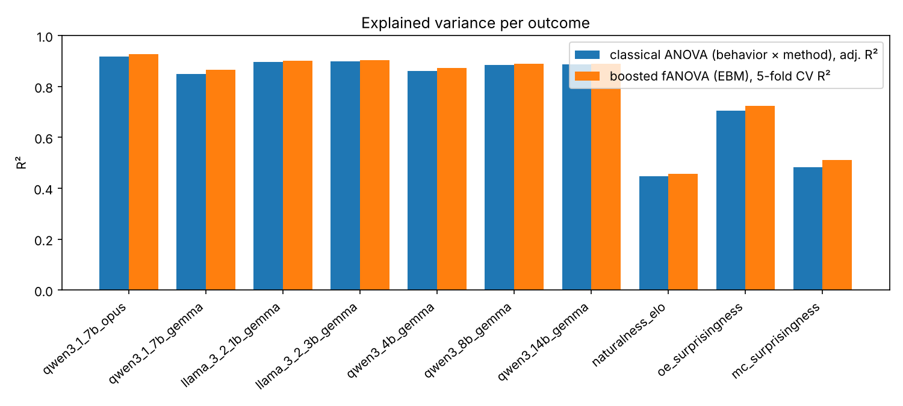
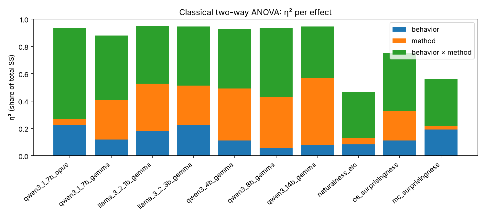
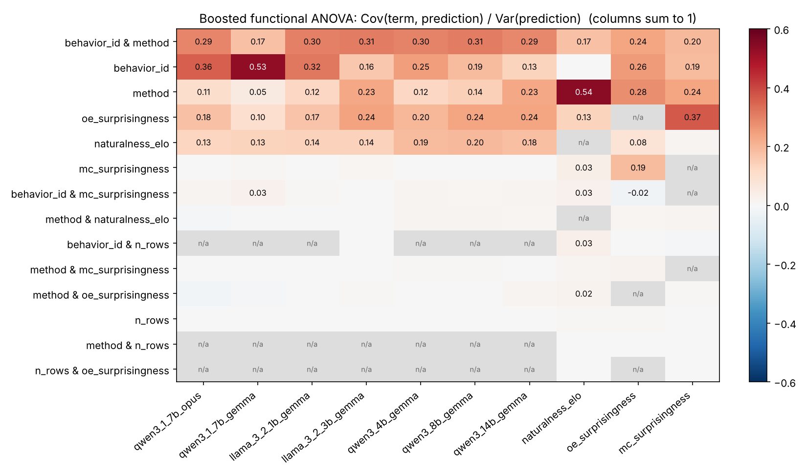

# Boosted ANOVA on Transluce/DSSE (scores.csv, all 6,915 datasets)

Source: https://huggingface.co/datasets/Transluce/DSSE (revision main, DSSE-1.1). The single `LLS` dataset was dropped because a factor level with one observation cannot be estimated, leaving 6,914 rows.

## Method

* **Classical two-way ANOVA** (type II SS): `outcome ~ behavior_id * method`. Reported: adjusted R² and η² per effect.
* **Boosted functional ANOVA**: an Explainable Boosting Machine (boosted GAM with up to 10 pairwise interactions) fit on `behavior_id`, `method`, `n_rows`, `naturalness_elo`, `oe_surprisingness`, `mc_surprisingness` (the outcome itself is excluded from the covariates). The additive model is a functional ANOVA decomposition; the variance of each term's contribution over the data, divided by the variance of the full prediction, is the term's share. Because terms are correlated (e.g. method is nested unevenly within behavior), the shares do not sum exactly to 1. Generalisation is measured with 5-fold CV R².

## Key findings

* **Elicitation is almost entirely a behavior × method story.** For all seven elicitation columns the classical model `behavior_id * method` already reaches adj. R² 0.85–0.92, and the boosted model adds only 0.003–0.016 CV R² on top, so the extra covariates and non-linearities add little.
* **The interaction dominates the classical ANOVA.** η² of behavior × method is 0.38–0.67 for elicitation, larger than either main effect for six of the seven outcomes (for `qwen3_14b_gemma` the method main effect, 0.49, exceeds the interaction, 0.38): which method works is strongly behavior-specific.
* **Judge matters for the attribution.** With the Opus judge (`qwen3_1_7b_opus`) behavior carries η² 0.23 and method only 0.04; with the Gemma judge on the same responses method rises to 0.29 and behavior falls to 0.12.
* **Transfer to larger models shifts weight from behavior to method.** From Qwen3-1.7B to Qwen3-14B the boosted share of `behavior_id` falls from 0.58 to 0.17 while `method` rises from 0.03 to 0.11 (and classical η²(method) from 0.29 to 0.49).
* **Surprisingness predicts elicitation.** `oe_surprisingness` is the third-largest term for every elicitation outcome (share 0.08–0.18), in a boosted model that already controls for behavior and method.
* **Naturalness is mostly a method effect** (boosted share 0.54) and is hard to predict overall (CV R² 0.46).
* **mc_surprisingness is best explained by oe_surprisingness** (share 0.30), i.e. the two auditor measures agree.

## Summary per outcome

| outcome            |    n |   classical_R2_adj |   ebm_R2_cv5 |   classical_eta2_behavior |   classical_eta2_method |   classical_eta2_behavior_x_method |   classical_p_interaction |   ebm_main_share |   ebm_interaction_share | ebm_top_term      |   ebm_top_term_share |
|:-------------------|-----:|-------------------:|-------------:|--------------------------:|------------------------:|-----------------------------------:|--------------------------:|-----------------:|------------------------:|:------------------|---------------------:|
| qwen3_1_7b_opus    | 6909 |              0.918 |        0.926 |                     0.226 |                   0.042 |                              0.668 |                         0 |            0.707 |                   0.331 | behavior_id       |                0.435 |
| qwen3_1_7b_gemma   | 6909 |              0.848 |        0.865 |                     0.12  |                   0.29  |                              0.471 |                         0 |            0.778 |                   0.24  | behavior_id       |                0.585 |
| llama_3_2_1b_gemma | 6909 |              0.897 |        0.902 |                     0.179 |                   0.348 |                              0.423 |                         0 |            0.665 |                   0.321 | behavior_id       |                0.395 |
| llama_3_2_3b_gemma | 6909 |              0.899 |        0.904 |                     0.222 |                   0.29  |                              0.433 |                         0 |            0.555 |                   0.296 | behavior_id       |                0.222 |
| qwen3_4b_gemma     | 6909 |              0.861 |        0.873 |                     0.112 |                   0.38  |                              0.437 |                         0 |            0.615 |                   0.333 | behavior_id       |                0.31  |
| qwen3_8b_gemma     | 6909 |              0.884 |        0.89  |                     0.059 |                   0.369 |                              0.508 |                         0 |            0.586 |                   0.321 | behavior_id       |                0.252 |
| qwen3_14b_gemma    | 6909 |              0.886 |        0.889 |                     0.078 |                   0.491 |                              0.379 |                         0 |            0.513 |                   0.276 | behavior_id       |                0.174 |
| naturalness_elo    | 6909 |              0.448 |        0.457 |                     0.083 |                   0.046 |                              0.339 |                         0 |            0.766 |                   0.255 | method            |                0.543 |
| oe_surprisingness  | 6909 |              0.705 |        0.723 |                     0.111 |                   0.217 |                              0.421 |                         0 |            0.547 |                   0.208 | behavior_id       |                0.227 |
| mc_surprisingness  | 6909 |              0.482 |        0.511 |                     0.191 |                   0.023 |                              0.349 |                         0 |            0.674 |                   0.164 | oe_surprisingness |                0.304 |

## Boosted fANOVA: term shares (share of prediction variance)

| term                                |   qwen3_1_7b_opus |   qwen3_1_7b_gemma |   llama_3_2_1b_gemma |   llama_3_2_3b_gemma |   qwen3_4b_gemma |   qwen3_8b_gemma |   qwen3_14b_gemma |   naturalness_elo |   oe_surprisingness |   mc_surprisingness |
|:------------------------------------|------------------:|-------------------:|---------------------:|---------------------:|-----------------:|-----------------:|------------------:|------------------:|--------------------:|--------------------:|
| behavior_id                         |             0.435 |              0.585 |                0.395 |                0.222 |            0.31  |            0.252 |             0.174 |             0.15  |               0.227 |               0.224 |
| behavior_id & method                |             0.225 |              0.153 |                0.208 |                0.198 |            0.209 |            0.194 |             0.174 |             0.14  |               0.152 |               0.112 |
| oe_surprisingness                   |             0.161 |              0.084 |                0.14  |                0.152 |            0.151 |            0.179 |             0.144 |             0.061 |               0     |               0.304 |
| method                              |             0.05  |              0.028 |                0.06  |                0.119 |            0.049 |            0.054 |             0.112 |             0.543 |               0.178 |               0.138 |
| naturalness_elo                     |             0.062 |              0.081 |                0.07  |                0.06  |            0.105 |            0.1   |             0.083 |             0     |               0.03  |               0.005 |
| behavior_id & oe_surprisingness     |             0.059 |              0.024 |                0.065 |                0.055 |            0.047 |            0.063 |             0.051 |             0.042 |               0     |               0.012 |
| behavior_id & naturalness_elo       |             0.038 |              0.043 |                0.034 |                0.024 |            0.058 |            0.046 |             0.03  |             0     |               0.031 |               0.02  |
| mc_surprisingness                   |             0     |              0.001 |                0     |                0.001 |            0     |            0     |             0     |             0.009 |               0.11  |               0     |
| behavior_id & mc_surprisingness     |             0.002 |              0.006 |                0.001 |                0     |            0.004 |            0.003 |             0.004 |             0.02  |               0.011 |               0     |
| method & naturalness_elo            |             0.002 |              0.006 |                0.004 |                0.005 |            0.008 |            0.008 |             0.007 |             0     |               0.004 |               0.007 |
| method & oe_surprisingness          |             0.002 |              0.003 |                0.002 |                0.002 |            0.001 |            0.002 |             0.004 |             0.015 |               0     |               0.005 |
| behavior_id & n_rows                |             0     |              0     |                0     |                0     |            0     |            0     |             0     |             0.029 |               0.001 |               0.002 |
| naturalness_elo & oe_surprisingness |             0.002 |              0.002 |                0.003 |                0.009 |            0.004 |            0.004 |             0.005 |             0     |               0     |               0.003 |
| method & mc_surprisingness          |             0     |              0.001 |                0     |                0     |            0.001 |            0.001 |             0.001 |             0.003 |               0.005 |               0     |
| n_rows & naturalness_elo            |             0.001 |              0.001 |                0.001 |                0     |            0     |            0.001 |             0.001 |             0     |               0.002 |               0.002 |
| n_rows                              |             0     |              0     |                0     |                0     |            0     |            0     |             0     |             0.002 |               0.003 |               0.002 |

## Classical ANOVA tables

### qwen3_1_7b_opus

|                    |   sum_sq |   df |       F |    PR(>F) |   eta2_partial |   eta2 |
|:-------------------|---------:|-----:|--------:|----------:|---------------:|-------:|
| behavior_id        |  76.1878 |   17 | 1428.77 | 0         |         0.7794 | 0.2256 |
| method             |  14.3359 |    3 | 1523.45 | 3.56e-301 |         0.3994 | 0.0425 |
| behavior_id:method | 225.613  |   51 | 1410.33 | 0         |         0.9128 | 0.6681 |
| Residual           |  21.5586 | 6873 |  nan    |           |         0.5    | 0.0638 |

### qwen3_1_7b_gemma

|                    |   sum_sq |   df |        F |    PR(>F) |   eta2_partial |   eta2 |
|:-------------------|---------:|-----:|---------:|----------:|---------------:|-------:|
| behavior_id        |  38.1008 |   17 |  405.75  | 1.13e-242 |         0.5009 | 0.12   |
| method             |  92.0459 |    3 | 5554.65  | 0         |         0.708  | 0.2898 |
| behavior_id:method | 149.515  |   51 |  530.747 | 0         |         0.7975 | 0.4707 |
| Residual           |  37.9641 | 6873 |  nan     |           |         0.5    | 0.1195 |

### llama_3_2_1b_gemma

|                    |   sum_sq |   df |        F |   PR(>F) |   eta2_partial |   eta2 |
|:-------------------|---------:|-----:|---------:|---------:|---------------:|-------:|
| behavior_id        |  94.4055 |   17 |  1450.12 |        0 |         0.782  | 0.1791 |
| method             | 183.728  |    3 | 15992.2  |        0 |         0.8747 | 0.3485 |
| behavior_id:method | 222.743  |   51 |  1140.48 |        0 |         0.8943 | 0.4225 |
| Residual           |  26.3203 | 6873 |   nan    |          |         0.5    | 0.0499 |

### llama_3_2_3b_gemma

|                    |   sum_sq |   df |        F |   PR(>F) |   eta2_partial |   eta2 |
|:-------------------|---------:|-----:|---------:|---------:|---------------:|-------:|
| behavior_id        | 116.597  |   17 |  1644.5  |        0 |         0.8027 | 0.2223 |
| method             | 152.164  |    3 | 12161.5  |        0 |         0.8415 | 0.2901 |
| behavior_id:method | 227.112  |   51 |  1067.74 |        0 |         0.8879 | 0.433  |
| Residual           |  28.6649 | 6873 |   nan    |          |         0.5    | 0.0546 |

### qwen3_4b_gemma

|                    |   sum_sq |   df |         F |   PR(>F) |   eta2_partial |   eta2 |
|:-------------------|---------:|-----:|----------:|---------:|---------------:|-------:|
| behavior_id        |  51.8627 |   17 |   638.781 |        0 |         0.6124 | 0.1119 |
| method             | 176.083  |    3 | 12289.7   |        0 |         0.8429 | 0.38   |
| behavior_id:method | 202.657  |   51 |   832.026 |        0 |         0.8606 | 0.4373 |
| Residual           |  32.8247 | 6873 |   nan     |          |         0.5    | 0.0708 |

### qwen3_8b_gemma

|                    |   sum_sq |   df |         F |    PR(>F) |   eta2_partial |   eta2 |
|:-------------------|---------:|-----:|----------:|----------:|---------------:|-------:|
| behavior_id        |  29.6618 |   17 |   370.276 | 6.27e-223 |         0.478  | 0.0585 |
| method             | 187.238  |    3 | 13244.9   | 0         |         0.8525 | 0.3693 |
| behavior_id:method | 257.733  |   51 |  1072.45  | 0         |         0.8884 | 0.5083 |
| Residual           |  32.387  | 6873 |   nan     |           |         0.5    | 0.0639 |

### qwen3_14b_gemma

|                    |   sum_sq |   df |         F |   PR(>F) |   eta2_partial |   eta2 |
|:-------------------|---------:|-----:|----------:|---------:|---------------:|-------:|
| behavior_id        |  45.6147 |   17 |   593.941 |        0 |         0.595  | 0.0775 |
| method             | 288.954  |    3 | 21320.4   |        0 |         0.903  | 0.4912 |
| behavior_id:method | 222.678  |   51 |   966.485 |        0 |         0.8776 | 0.3785 |
| Residual           |  31.0498 | 6873 |   nan     |          |         0.5    | 0.0528 |

### naturalness_elo

|                    |      sum_sq |   df |        F |   PR(>F) |   eta2_partial |   eta2 |
|:-------------------|------------:|-----:|---------:|---------:|---------------:|-------:|
| behavior_id        | 2.68146e+07 |   17 |  62.7514 | 5.09e-40 |         0.1344 | 0.0826 |
| method             | 1.47876e+07 |    3 | 196.101  | 5.93e-44 |         0.0788 | 0.0456 |
| behavior_id:method | 1.10112e+08 |   51 |  85.8945 | 0        |         0.3893 | 0.3394 |
| Residual           | 1.72761e+08 | 6873 | nan      |          |         0.5    | 0.5324 |

### oe_surprisingness

|                    |   sum_sq |   df |        F |    PR(>F) |   eta2_partial |   eta2 |
|:-------------------|---------:|-----:|---------:|----------:|---------------:|-------:|
| behavior_id        |  80.3845 |   17 |  178.661 | 1.52e-111 |         0.3066 | 0.111  |
| method             | 157.475  |    3 | 1983.33  | 0         |         0.4642 | 0.2174 |
| behavior_id:method | 304.859  |   51 |  225.857 | 0         |         0.6265 | 0.4208 |
| Residual           | 181.771  | 6868 |  nan     |           |         0.5    | 0.2509 |

### mc_surprisingness

|                    |   sum_sq |   df |       F |   PR(>F) |   eta2_partial |   eta2 |
|:-------------------|---------:|-----:|--------:|---------:|---------------:|-------:|
| behavior_id        | 249.02   |   17 | 177.471 | 7.9e-111 |         0.3051 | 0.1915 |
| method             |  29.9672 |    3 | 121.023 | 6.45e-28 |         0.0502 | 0.023  |
| behavior_id:method | 454.189  |   51 | 107.897 | 0        |         0.4447 | 0.3493 |
| Residual           | 567.207  | 6872 | nan     |          |         0.5    | 0.4362 |
